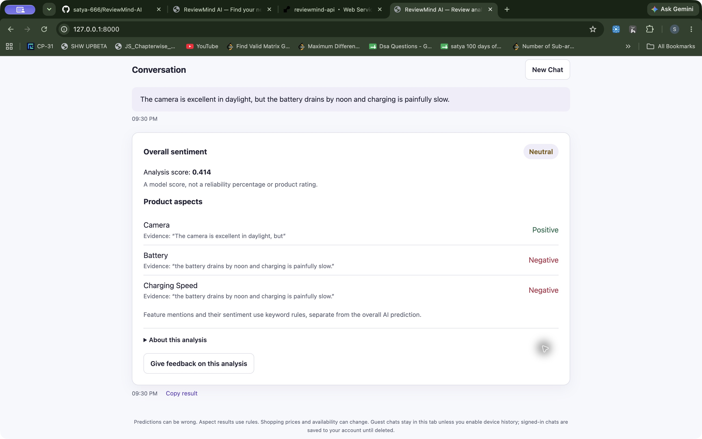
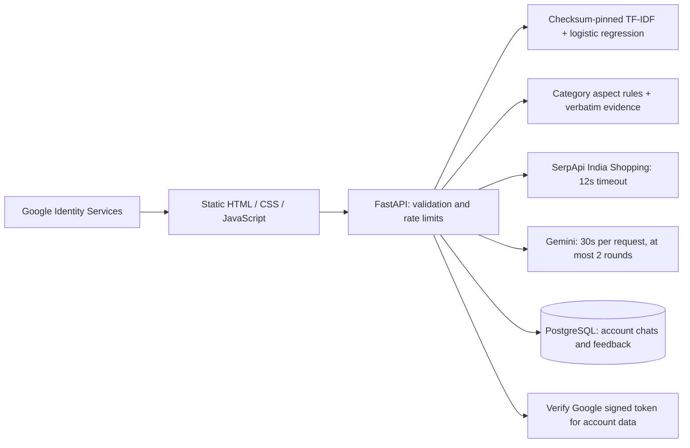

# ReviewMind AI

[Live demo](https://reviewmind-web.onrender.com/) · [Evaluation report](reports/portfolio_evaluation.md) · [Source repository](https://github.com/satya-666/ReviewMind-AI)

An applied ML demo that separates **trained review classification** from **provider-backed shopping advice**. Analyze overall sentiment with TF-IDF + logistic regression, inspect category-specific aspect rules and exact review evidence, or retrieve India shopping listings with source links.



## Try it

Open the live demo, choose **Analyze a review** (the default), and click **Try sample review**. The smartphone review remains editable; click **Analyze** to run the actual classifier. Review analysis works with third-party processing switched off and without signing in.

Choose **Ask for shopping advice** for Gemini and optional SerpApi India Shopping retrieval. Third-party processing requires consent. Explicit shopping requests retrieve evidence before generating a comparison; a provider failure shows its status and a retry control. Missing prices/specifications/availability remain unknown. No simulated listings or silent sample fallback are presented as live results.

Google sign-in enables account-owned server chat history, reopen/continue, and deletion. Guest history stays in the tab by default; optional device history can be enabled in Settings. Google identity tokens stay in memory, so a reload requires signing in again for account history. No Gmail inbox access is requested.

## Architecture



The overall classifier and lexical aspects are distinct outputs. Aspect polarity is not a feature attribution for the classifier. Review text is not sent to shopping/AI providers in explicit review mode. Guest reviews are not stored by the API; signed-in chats are stored until the user deletes them. Feedback stores prediction metadata and optional feedback for 30 days, separately from chat history.

## Run locally

Python 3.14 and Node.js are used by the current environment. Install pinned serving dependencies; the small serving checkpoint is included in this repository.

```sh
python3 -m venv .venv
.venv/bin/python -m pip install -r backend/requirements.txt
cp backend/model_metadata.json models/phase3/full/baseline/logistic_regression.metadata.json
.venv/bin/python scripts/verify_serving_model.py
node scripts/build_frontend.mjs
.venv/bin/python -m uvicorn backend.app.main:app --host 127.0.0.1 --port 8000 --no-access-log
```

Open `http://127.0.0.1:8000`. Development defaults use SQLite and no external credentials. Settings are read from process environment; `.env.example` documents names (a `.env` file is not automatically loaded).

| Environment variable | Example / purpose |
|---|---|
| `APP_ENV` | `development` locally; `production` on Render |
| `MODEL_PATH` | `models/phase3/full/baseline/logistic_regression.joblib`; Docker uses `/app/runtime/model.joblib` |
| `DATABASE_URL` | Local SQLite by default; existing Render PostgreSQL in production |
| `AUTO_CREATE_DB` | `true` locally; `false` in production; startup applies Alembic migrations |
| `ALLOWED_HOSTS` | `localhost,127.0.0.1`; exact backend hostname in production |
| `ALLOWED_ORIGINS` | `http://127.0.0.1:8000`; exact HTTPS frontend origin in production |
| `FRONTEND_API_URL` | Empty for same-origin local app; `https://reviewmind-api.onrender.com` for static host |
| `GOOGLE_CLIENT_ID` | `<public-web-client-id>.apps.googleusercontent.com`; account features only |
| `GEMINI_MODEL` | `gemini-3.1-flash-lite` |
| `GEMINI_API_KEY` | `<backend-secret>`; optional conversation |
| `SERPAPI_API_KEY` | `<backend-secret>`; optional live shopping retrieval |
| `RATE_LIMIT_PER_MINUTE` / `GLOBAL_RATE_LIMIT_PER_MINUTE` | `20` / `120` defaults |

Set keys directly in backend deployment secrets. Never put them in frontend configuration, URLs, commits or chat. [Google identity setup](docs/GOOGLE_AUTH.md) · [Product provider setup](docs/PRODUCT_RETRIEVAL.md).

## Reproduce training and evaluation

```sh
.venv/bin/python -m pip install -r requirements.txt
.venv/bin/python scripts/download.py
.venv/bin/python scripts/inspect_data.py
.venv/bin/python scripts/run_pipeline.py
# Optional: retrain and select classical models using validation only
.venv/bin/python scripts/run_phase3.py --mode baseline
# Refit frozen serving parameters on train, verify TF-IDF/checkpoint and evaluate
.venv/bin/python scripts/evaluate_portfolio.py
```

The evaluation command checks split identities and exact/near-text duplicate groups, reproduces train-only TF-IDF vocabulary and IDF, compares checkpoint predictions with a frozen refit, and evaluates a majority class chosen **only from train** on the same test. It does not overwrite the serving model. Training output is ignored by Git; changing the deployed model also requires deliberately updating and verifying its checksum manifest.

Data: [Nirali Vaghani, Flipkart Product reviews with sentiment Dataset v1](https://www.kaggle.com/datasets/niraliivaghani/flipkart-product-customer-reviews-dataset), archive SHA-256 `993e30bc378df9a93563106e489068b8510d26302a40913714c09bf82151df2a`. Publisher declares ODbL / DbCL. Preserve attribution and applicable notices; publisher licensing does not establish all underlying marketplace rights. Raw customer text is excluded from Git. [Provenance, terms and preparation](docs/PHASE_1.md) · [Source inventory](reports/dataset_sources.csv).

Available technology reviews: 23,322 before the additional token-canonical leakage quarantine. Evaluation uses 18,367 train, 2,489 validation and 2,451 test rows. Labels are **rating-derived weak labels**: stars 1–2 negative, 3 neutral, 4–5 positive. They are not independent human sentiment annotations.

| Model | Held-out reviews | Macro F1 |
|---|---:|---:|
| Train-majority baseline | 2,451 | 0.2817 |
| Serving TF-IDF + logistic regression | 2,451 | **0.6728** |

| Class | Test count | Precision | Recall |
|---|---:|---:|---:|
| Negative | 474 | 0.8103 | 0.8650 |
| Neutral | 184 | 0.2286 | 0.3043 |
| Positive | 1,793 | 0.9459 | 0.8968 |

Confusion matrix, rows=true / columns=predicted, negative / neutral / positive:

```text
410   42    22
 58   56    70
 38  147  1608
```

The retained-row duplicate audit detected zero cross-split groups under seeded MinHash candidate search and character 5-gram Jaccard ≥0.90 for long text; approximate retrieval cannot prove every possible duplicate is absent. [Full measured results, slice counts and limitations](reports/portfolio_evaluation.md) · [Machine-readable results](reports/portfolio_evaluation.json).

Real rating-label disagreements are recorded by review ID in that report. Run the evaluation command to inspect their exact text locally in `data/interim/portfolio_errors.json`; this file is deliberately excluded from publication. Ten transparently authored manual aspect diagnostics measure mention detection separately from polarity: detection precision/recall 1.000/1.000, matched-aspect polarity accuracy 0.833 (12 aspects). This tiny, developer-authored set is a diagnostic, not an independent ABSA benchmark.

## Checks and deployment

```sh
.venv/bin/python -m pytest -q
node --test tests/test_api_client.mjs tests/test_auth_client.mjs tests/test_demo_flow.mjs
FRONTEND_API_URL=https://reviewmind-api.onrender.com node scripts/build_frontend.mjs
```

Full Python checks require locally prepared datasets and transformer artifacts for the historical research tests. PostgreSQL integration checks require `TEST_POSTGRES_URL`; otherwise that integration test is skipped. Focused serving tests can run without acquiring the dataset (see `tests/test_portfolio_demo.py`, `tests/test_web_api.py`, `tests/test_products.py`).

Existing Render services are separate: static `reviewmind-web` and Docker `reviewmind-api`, both using `phase-3.5/web-integration`. Dashboard auto-deploys have been observed on branch pushes; `render.yaml` is a preparation blueprint with automatic deployment disabled and is **not** the live service configuration. Do not create a new blueprint or paid resource for this release. [Release evidence](docs/PORTFOLIO_RELEASE.md).

## Known limits

- Neutral-class recall is weak. Probabilities are uncalibrated; no reliability percentages or fake-review detection are claimed.
- No smartphone or Hindi training examples are available. Hinglish test coverage is too small for a reliable claim. Mixed/negation slices use lexical markers and weak labels; the existing holdout has already been inspected.
- Aspect rules miss context, negation and unlisted synonyms. Evidence quotes identify rule context, not causal explanations for the trained classifier.
- Free Render cold starts can exceed 50 seconds. The UI bounds warm-up and requests; Gemini and search can still time out or hit quota. Sources are retrieved listings, not independently verified checkout offers or evidence that one product has better calls/battery.
- Account history is capped at 100 chats / 100 messages per chat; optional guest device history keeps the latest 20 chats. Guest and account histories are separate. Identity reload needs sign-in again.
- The repository may remain private pending owner approval; a signed-out GitHub 404 alone does not prove a wrong URL. No source-code license has been selected. Historical research details remain in [Phase 2](docs/PHASE_2.md) and [Phase 3](docs/PHASE_3.md).
