# ReviewMind AI — Phase 2 exploratory data analysis

## 1. Executive Summary

Analyzed **23,322 real retained reviews** across **75 exact-name product groups** and **7 represented technology categories**. Verified unique catalog-product count is unavailable. All figures and counts use existing Phase 1 data; no new dataset was downloaded or modified.

Mean rating: 4.205; median: 5.0. High-rated (4–5 stars): 80.9322%. Unknown or low-confidence/manual-review language labels: 45.6222%.

EDA implementation and execution are complete on available data. Temporal drift and true catalog/customer/geographic identity analyses remain unavailable. No inferential significance or causal/product-quality claim is made.

## 2. Dataset Description

Source: Nirali Vaghani, Flipkart Product reviews with sentiment Dataset, version 1. Acquisition recorded 2026-10-31. Phase 2 reads the retained train/validation/test artifacts, not all mixed-domain raw records.

| Split | Reviews |
|---|---:|
| train | 18367 |
| validation | 2492 |
| test | 2463 |

| Source | Reviews |
|---|---:|
| niraliivaghani/flipkart-product-customer-reviews-dataset | 23322 |

Usable text + available rating: 23,322/23,322 (100.0%). This definition does not establish independent customers, accurate languages or reliable catalog identity.

Average/median reviews per product-name group: 310.96 / 200.0.

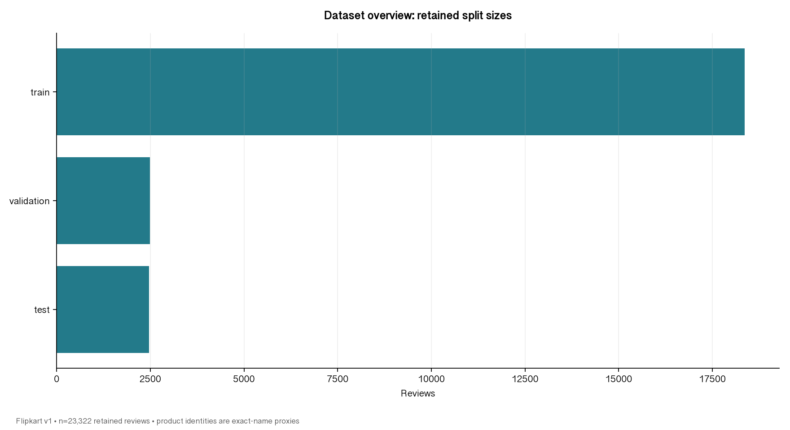

## 3. Data Quality

Required-schema validation passed: **True**. Split reproduction verified: **True**. Phase 1 artifact checksums verified: **True**.

| Schema field | Missing % |
|---|---:|
| review_id | 0.0 |
| product_id | 100.0 |
| product_name | 0.0 |
| product_category | 0.0 |
| source_platform | 0.0 |
| source_dataset | 0.0 |
| review_text | 0.0 |
| rating | 0.0 |
| review_date | 100.0 |
| language | 0.0 |
| verified_purchase | 100.0 |
| helpful_votes | 100.0 |
| market | 0.0 |
| source_record_id | 0.0 |

All 23,322 rows lack at least one schema field. Missing catalog IDs, dates, purchase verification and helpful votes are explicit nulls. Empty cleaned texts: 0; encoding warnings: 0.

Publisher cleaned text before release; preserved source strings are not recoverable marketplace originals. Identical phrases are ambiguous without customer IDs. No silent repairs, translations or balancing were performed.

## 4. Rating Analysis

| Stars | Reviews |
|---|---:|
| 1 | 2387 |
| 2 | 570 |
| 3 | 1490 |
| 4 | 4306 |
| 5 | 14569 |

Low-rated (1–2 stars): 12.679%; high-rated (4–5 stars): 80.9322% (denominator: valid star ratings).

| Rating-derived weak overall sentiment | Reviews |
|---|---:|
| negative | 2957 |
| neutral | 1490 |
| positive | 18875 |
| unavailable | 0 |

These labels are exploratory proxies: 1–2 negative, 3 neutral, 4–5 positive. They are not human-verified sentiment or aspect annotations. High overall ratings can include negative opinions about particular aspects. No classifier was trained.

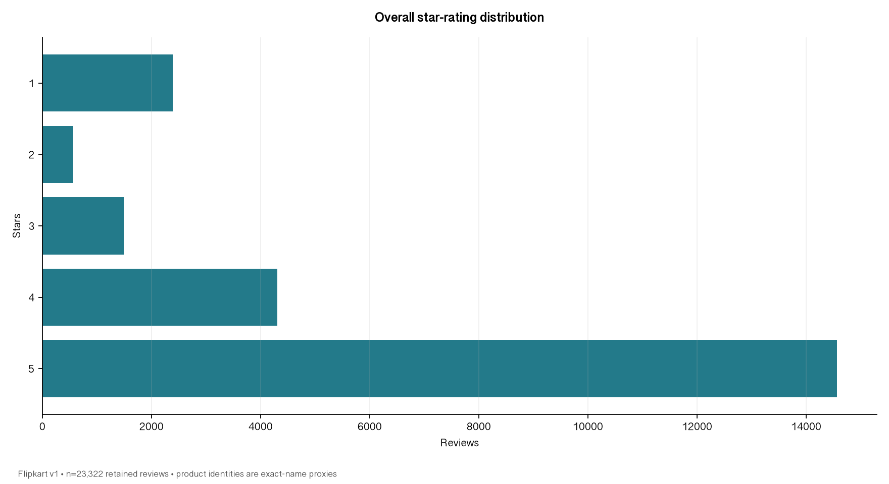
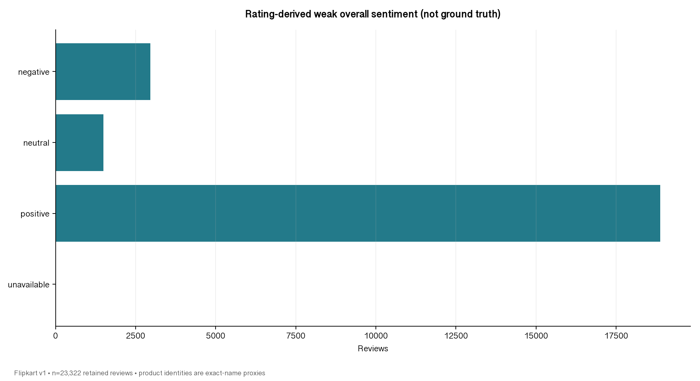
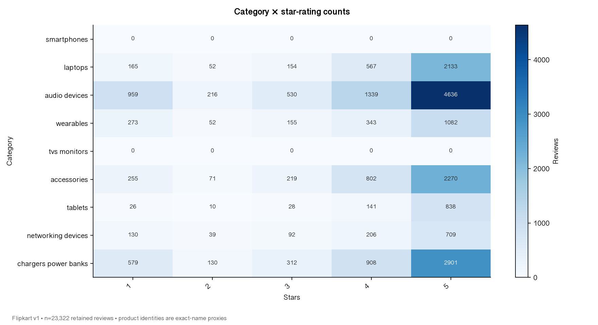

## 5. Category Analysis

| Category | Reviews |
|---|---:|
| smartphones | 0 |
| laptops | 3071 |
| audio_devices | 7680 |
| wearables | 1905 |
| tvs_monitors | 0 |
| accessories | 3617 |
| tablets | 1043 |
| networking_devices | 1176 |
| chargers_power_banks | 4830 |
| unknown | 0 |

Smartphones and TVs/monitors have zero records. Product-group dominance and underrepresented Indian-language coverage are measured per category in phase2_metrics.json. Thresholds in phase2_config.yaml are exploratory flags, not universal evidence standards.

| Category | Largest group review share % |
|---|---:|
| smartphones | None |
| laptops | 24.4871 |
| audio_devices | 16.0286 |
| wearables | 84.8819 |
| tvs_monitors | None |
| accessories | 55.2668 |
| tablets | 100.0 |
| networking_devices | 67.8571 |
| chargers_power_banks | 41.5321 |

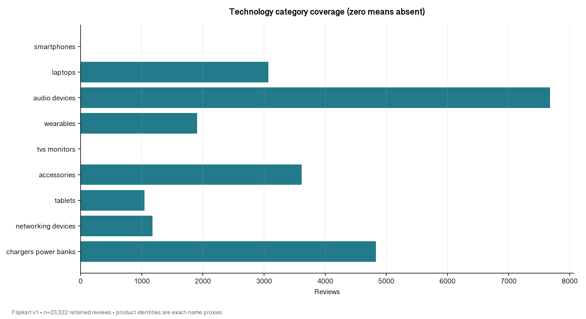
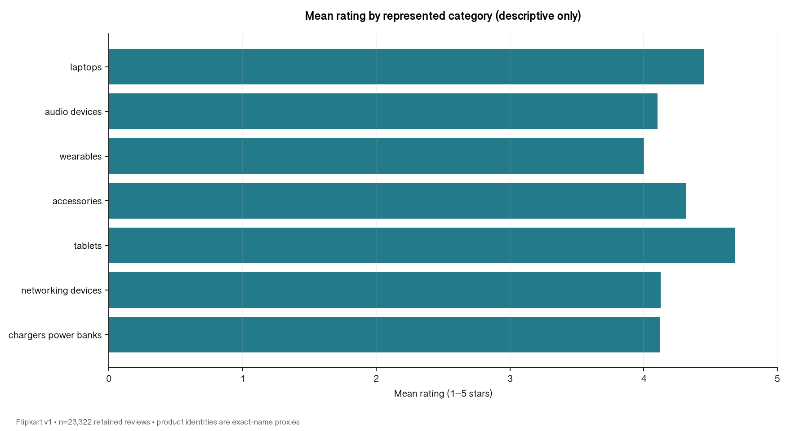
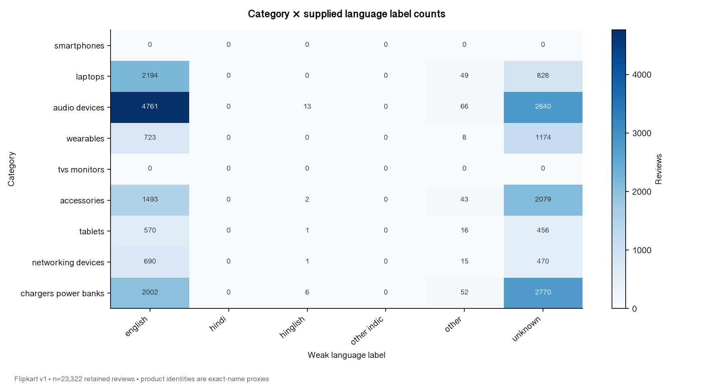

## 6. Multilingual Analysis

| Supplied language label | Reviews |
|---|---:|
| english | 12433 |
| hindi | 0 |
| hinglish | 23 |
| other_indic | 0 |
| other | 249 |
| unknown | 10617 |

| Supplied language label | % |
|---|---:|
| english | 53.3102 |
| hindi | 0.0 |
| hinglish | 0.0986 |
| other_indic | 0.0 |
| other | 1.0677 |
| unknown | 45.5235 |

Confidence unavailable for 39.958% of rows. Numeric confidence scores are uncalibrated; a high detector score does not validate a language label. Romanized Hindi is not assumed to be English.

Hindi/other Indic coverage is absent and the Hinglish sample is far too small for a defensible multilingual training/evaluation claim. Obtain licensed, independently annotated code-mixed evaluation data before assessing multilingual performance.

A seed-42 sample of unknown, Hinglish and other labels is saved locally at data/interim/phase2_language_sample.json for human inspection; raw text/excerpts are not committed. Review observations are in docs/PHASE_2_LANGUAGE_REVIEW.md. The sample is diagnostic, not a statistically representative accuracy study, and no labels were overwritten.

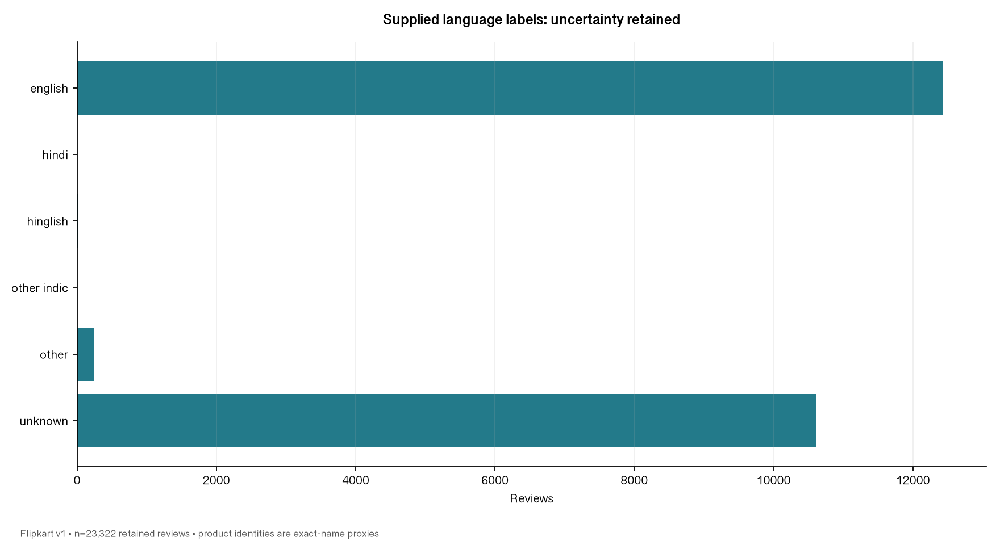

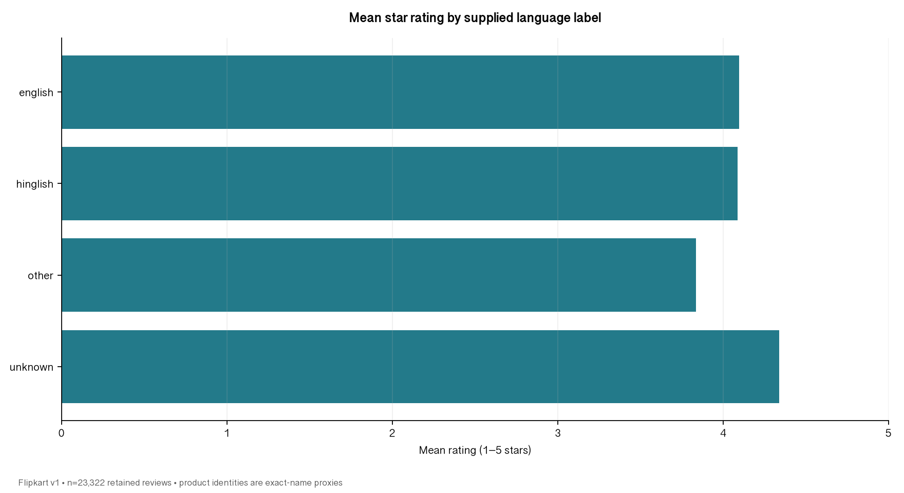

## 7. Product-Level and Text Analysis

| Reviews per product-name group | Groups |
|---|---:|
| fewer_than_5 | 1 |
| 5_to_20 | 1 |
| 21_to_100 | 26 |
| more_than_100 | 47 |

Top 1 group accounts for 8.6013% of reviews; top 10 account for 49.6184%. Unweighted mean of product-group mean ratings: 4.036.

Provisional minimum evidence floor: 20 reviews; 1 groups fall below it. This is not a reliability guarantee: validate independent-customer counts, uncertainty and sensitivity to repeated text before scoring products.

Mean/median character length: 69.62/28.0; mean/median whitespace word count: 12.74/5.0. Short reviews (fewer than 3 whitespace-separated words): 31.4381%. Long reviews (more than 200 whitespace-separated words): 0.0%.

Unigram/bigram document frequencies use Unicode letters and combining marks, with no universal English stopword list. Public terms meet a minimum review-frequency threshold after contact-pattern redaction. Frequent terms are not validated product aspects. Full numeric distributions (quantiles) and group summaries are in JSON.

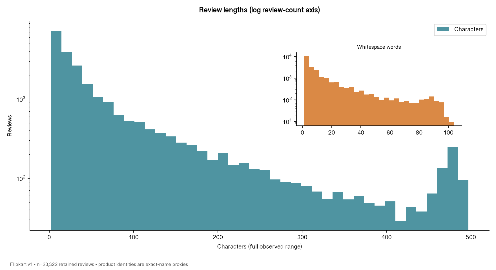
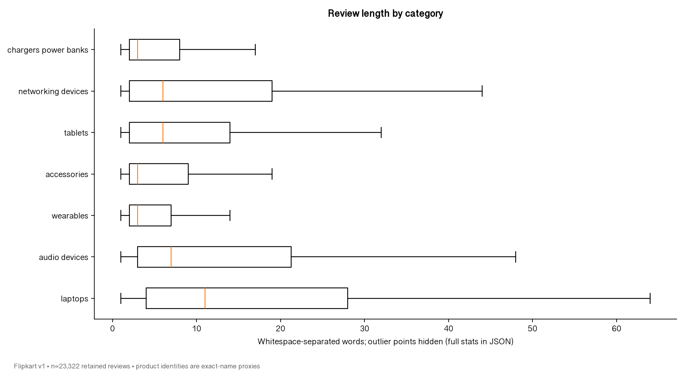
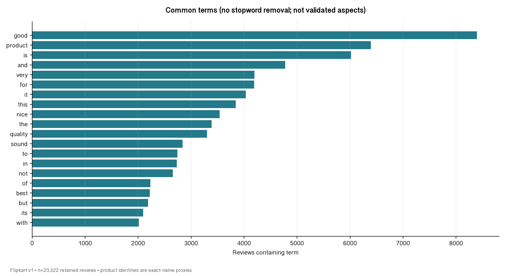
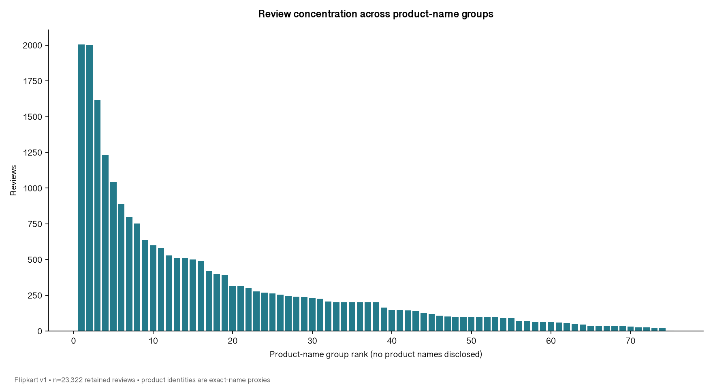
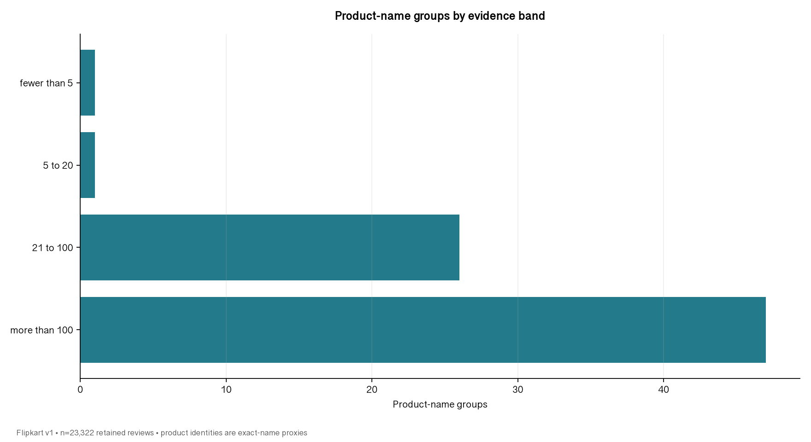

## 8. Dataset Bias and Leakage

Verified: normalized exact-text cross-split groups = 0; retained repeated normalized-text rows within splits = 8684; exact-name product-group overlaps = 0.

Secondary token-canonical screen finds **13 cross-split groups** affecting 1766 rows. Dropping punctuation/emojis/one-character tokens can overmerge generic phrases; these are similarity warnings, not proven duplicate customer identities.

Bounded independent near-text screen: 5673 sampled reviews, 0 cross-split candidates checked, 0 pairs with Jaccard >= 0.9. Seed and per-split sample sizes are in JSON. A zero result would not prove absence outside the sample or LSH candidates.

Phase 1 grouping/checksum reproduction does not imply robust catalog-disjoint or semantic-leakage-free evaluation. Similar variants may cross name groups. Shared generic phrases and repeated rows can inflate apparent evidence. Evaluation quarantine shifts language/rating/category distributions; tablet evaluation is unavailable because its groups all reside in training.

Verified geographic evidence is an India marketplace source, not individual customer residence. No customer countries are verified. All review dates are missing; temporal distribution and drift cannot be assessed. Collection-time information is not substituted for review dates.

Full-dataset EDA intentionally examines held-out distributions. Treat these splits as exploratory/development data and reserve a fresh independent final holdout for confirmatory evaluation.

## 9. Research Findings

- The dataset is single-source and skewed toward high overall ratings; raw accuracy alone would hide weak-label class imbalance.
- Category representation and product evidence are uneven; there is no support for nine-category performance claims.
- Sparse Hinglish and absent Hindi data prevent credible multilingual evaluation; uncertain short reviews dominate language uncertainty.
- Product-name groups and repeated phrases do not establish distinct products or independent reviewers. All findings here are descriptive; no significance tests or confidence intervals for independent customers are claimed.

## 10. Recommendations for Phase 3

Start with a majority-class baseline and word/character TF-IDF linear baseline on training-only features, evaluated against explicitly weak rating labels. Report macro F1, balanced accuracy, per-class precision/recall, and confusion matrices rather than raw accuracy alone ([scikit-learn metrics](https://scikit-learn.org/stable/modules/model_evaluation.html)). This is a proposed plan; no model is trained in Phase 2.

Only after acquiring a licensed, human-reviewed multilingual evaluation set, compare multilingual encoders such as [mBERT](https://huggingface.co/google-bert/bert-base-multilingual-cased) or [XLM-R](https://huggingface.co/FacebookAI/xlm-roberta-base). Their multilingual pretraining does not establish suitability for Romanized Hindi or this domain. Model-card references were inspected for planning; no model weights were downloaded.

Tune sampling/class weights using training data alone. Report per-language/per-category results only where enough independent products and examples exist. Audit canonical overlap and catalog variants before freezing new splits; assess repeated-text sensitivity and group-level uncertainty. Keep missing categories/languages as collection gaps rather than oversampling fabricated evidence.

## 11. Limitations and Reproducibility

Source licensing remains publisher-declared ODbL/DbCL with attribution/database obligations; underlying third-party rights are not independently established. Preserve dataset_sources.csv restrictions and do not redistribute review records. No new license is selected here.

Run python scripts/run_phase2.py from the documented virtual environment. Config, SHA-256 input manifest and software versions are recorded in phase2_metrics.json. Phase 1 code and datasets are unchanged. Same-input reruns are tested for identical metrics; notebook kernels start fresh and commit only small aggregate outputs.

Unavailable analyses: review-time drift, verified catalog identity, customer geography, definitive fraud detection, language accuracy and human aspect sentiment. Phase 3 has not started.
