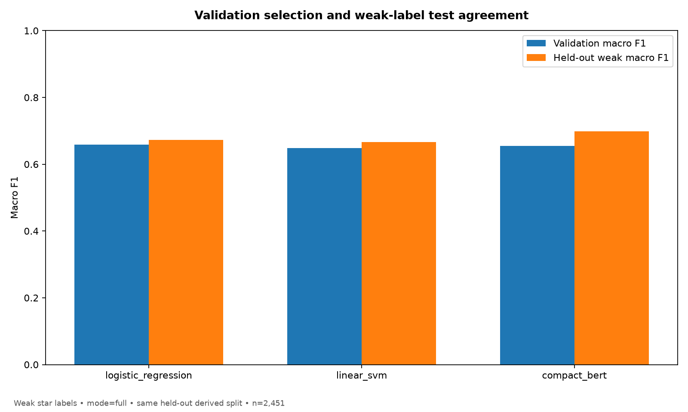
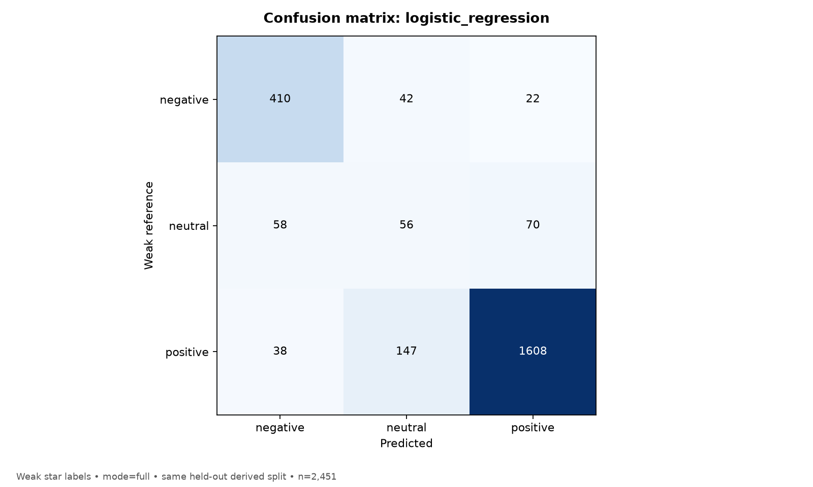
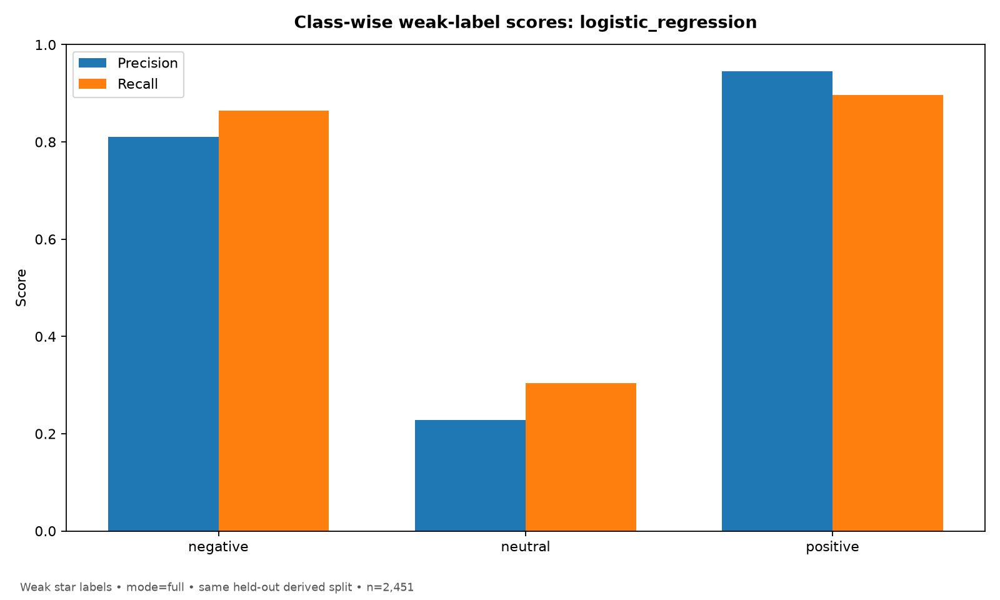
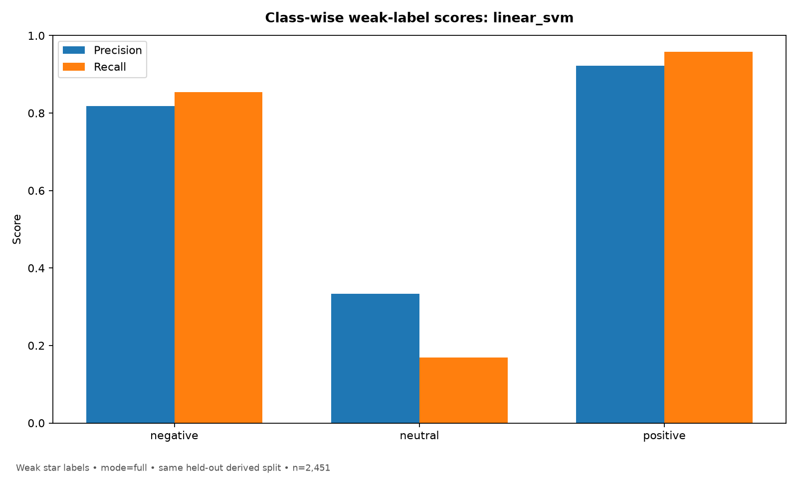
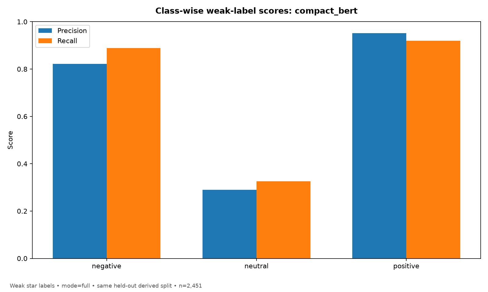
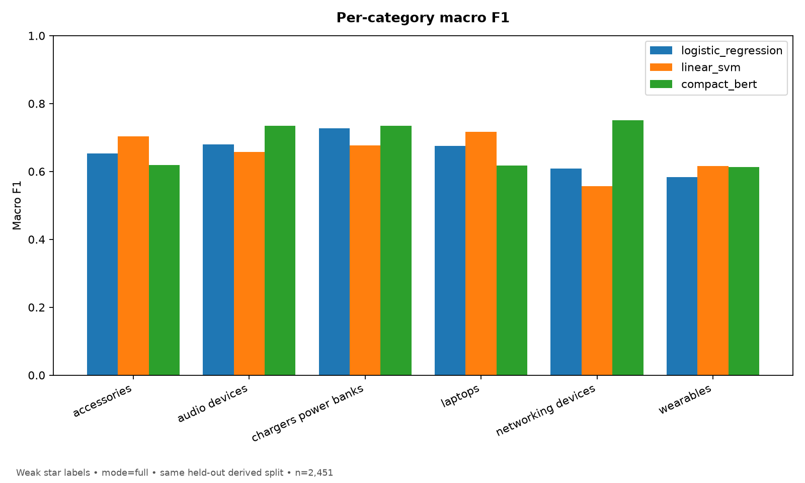
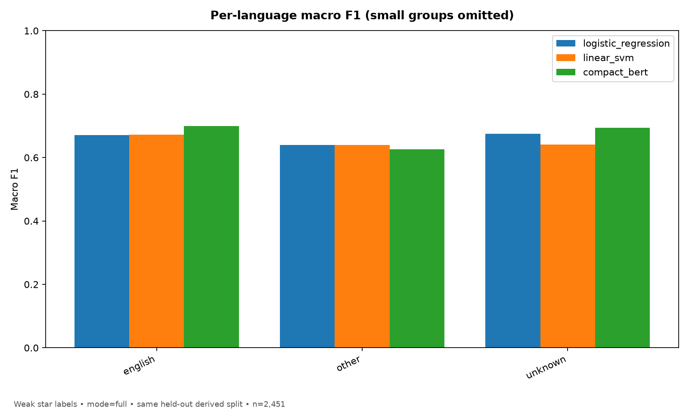
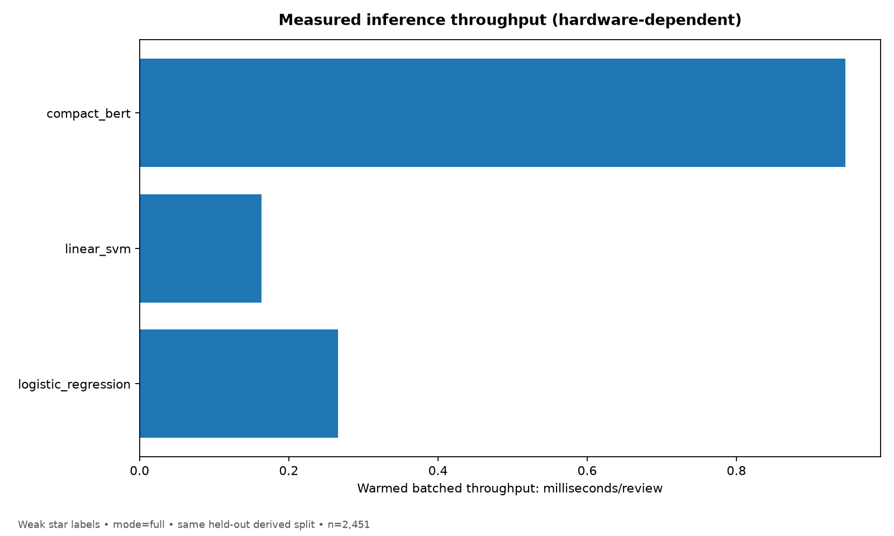
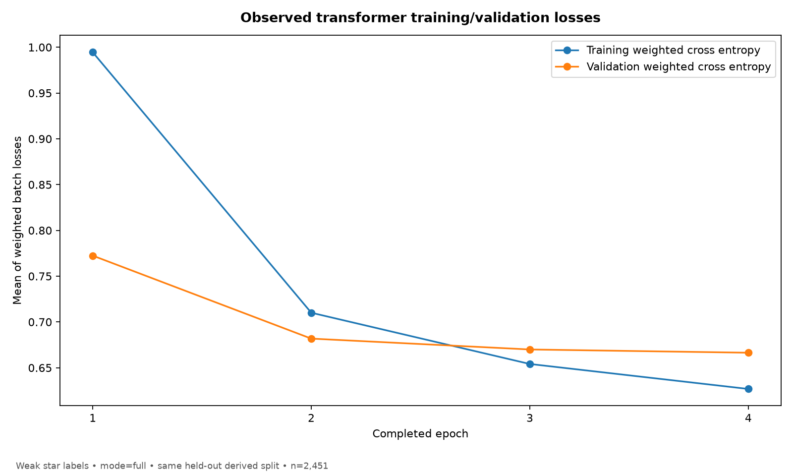

# ReviewMind AI — Phase 3 model report

## 1. Executive summary

Execution mode: **full**. Overall status: **partial_human_sentiment_and_supervised_absa_unavailable**.

Real classical models were fitted and evaluated. Transformer completion is listed below only if actual fine-tuning succeeded. Human-verified sentiment evaluation, supervised ABSA and reliable multilingual evaluation remain incomplete; the entire phase is therefore **partial**. No Phase 4 implementation is included.

## 2. Dataset and label provenance

Existing Flipkart Kaggle v1 records from Phase 1 are reused under the recorded publisher ODbL/DbCL terms and underlying-rights limitations. No customer-review dataset was downloaded. Original splits are unchanged. Exact-name product groups remain proxies, not verified catalog identities.

| Derived view | Reviews | Negative | Neutral | Positive |
|---|---:|---:|---:|---:|
| train | 18367 | 2073 | 1144 | 15150 |
| validation | 2489 | 410 | 160 | 1919 |
| test | 2451 | 474 | 184 | 1793 |

Canonical cross-split phrase quarantine removed: {'test': 12, 'validation': 3}. Only lower-priority evaluation rows are excluded; no test record moves into training. Source ID, exact-name group, recorded duplicate-group and canonical-key overlap checks pass.

Star ratings map 1–2/3/4–5 to negative/neutral/positive for overall weak supervision. Models receive text only, never rating, product ID or weak label as an input feature. Weak-label agreement is not evidence of genuine human or aspect-level sentiment understanding. The prior full-dataset EDA exposed holdout distributions; this is an exploratory development benchmark, not a fresh final holdout.

## 3. Experimental setup and reproducibility

Seed: 42. Source/split hashes, actual row counts, hyperparameters, package versions and hardware are recorded in phase3_results.json. MLflow parent run: `0c2fa686d1a64fa4abecd5999556631f`; tracking stays local in models/phase3/mlflow.db.

Hardware: {'machine': 'arm64', 'python': '3.14.6', 'cpu': 'Apple M3', 'ram_bytes': 8589934592, 'free_disk_bytes': 269572284416}. Measured total experiment time: 191.69 seconds. Input files unchanged: True.

## 4. Baseline architectures

Word 1–2-gram and character-within-word 3–5-gram TF-IDF feed Logistic Regression or Linear SVM. Vocabularies and IDF are fitted on training only. C and class weighting are selected by validation macro F1; all trial results are saved. No test feedback is used for tuning. Linear SVM margins are not probabilities; logistic probabilities are uncalibrated.

## 5. Transformer architecture and optimization

The feasible experiment uses [Google compact English BERT](https://huggingface.co/google/bert_uncased_L-2_H-128_A-2), Apache-2.0, 2 layers/128 hidden dimensions. It is not DistilBERT or XLM-R. A bounded stratified training subset, attention masks, seeded loaders, AdamW, linear warmup/decay, gradient accumulation/clipping, validation early stopping and best-checkpoint reload are implemented. MPS/CUDA are selected when available, with CPU fallback; mixed precision is restricted to CUDA.

Hyperparameters and completed-epoch losses are actual records in JSON. The compact model is a resource pilot with a smaller training budget than classical models; scores on the same held-out rows are comparable as predictions, not as equal-budget architecture experiments. Accelerator bitwise reproducibility is not guaranteed.

## 6. Aspect-based sentiment

Nine configurable category taxonomies drive alias mention extraction. Clause-scoped nearest positive/negative cues and limited negation handling produce heuristic aspect sentiment, with unknown/mixed output and no calibrated confidence. They never use star ratings.

Actual held-out coverage: 1094 of 2451 reviews contain extracted mentions. These are coverage counts, not precision/recall. Extraction F1 and aspect-sentiment F1 are **unavailable** because there are no genuine annotations. No supervised aspect model was trained.

SemEval-2014 laptop ABSA was inspected ([official task](https://alt.qcri.org/semeval2014/task4/), [data terms](https://alt.qcri.org/semeval2014/task4/index.php?id=data-and-tools)); the terms reference fair use/provider restrictions rather than verified unrestricted reuse. It was not downloaded or silently relicensed. SetFit mirror access could not be verified. See the annotation guide and local blank annotation queue.

## 7. Multilingual methodology

Hindi is absent and Hinglish training/evaluation groups are very small. No XLM-R/IndicBERT/MuRIL fine-tuning was attempted. Per-language weak metrics are reported only above the configured sample floor, with all three class supports retained. Unknown labels stay unknown; no translation or Roman-script-equals-English assumption is applied. No multilingual capability claim is supported.

## 8–10. Hyperparameters, evaluation and comparison

| Model | Validation macro F1 | Weak test accuracy | Weak test macro F1 | Weighted F1 | Training seconds | Artifact bytes |
|---|---:|---:|---:|---:|---:|---:|
| logistic_regression | 0.6593 | 0.8462 | 0.6728 | 0.8549 | 28.92 | 3028276 |
| linear_svm | 0.6488 | 0.8792 | 0.6667 | 0.8664 | 24.32 | 3028160 |
| compact_bert | 0.6547 | 0.8690 | 0.6988 | 0.8726 | 116.72 | 18262709 |

Best baseline: **logistic_regression**. Best feasible model by frozen validation macro F1: **logistic_regression**. Test results are not used to change this decision. Compare latency/size before choosing deployment; high class imbalance makes raw accuracy inadequate.

All models share the same derived held-out evaluation rows. Accuracy, macro precision/recall/F1, weighted F1, all class supports, confusion matrices and batched latency are in JSON. Product-group percentile bootstrap intervals use the configured seeded resamples and are exploratory: grouping identities and weak labels are uncertain, so nominal coverage is not guaranteed.

## 11. Per-category results

| Category | Reviews | logistic_regression | linear_svm | compact_bert |
|---|---:|---:|---:|---:|
| accessories | 414 | 0.6538 | 0.7031 | 0.6188 |
| audio_devices | 849 | 0.6799 | 0.6581 | 0.7347 |
| chargers_power_banks | 442 | 0.7278 | 0.6775 | 0.7341 |
| laptops | 396 | 0.6754 | 0.7173 | 0.6182 |
| networking_devices | 145 | 0.6092 | 0.5564 | 0.7508 |
| wearables | 205 | 0.5836 | 0.6158 | 0.6137 |

Smartphones and TVs/monitors remain unrepresented; tablet records are confined to training. No held-out performance is invented for missing categories.

## 12. Per-language results

| Supplied language label | Reviews | logistic_regression | linear_svm | compact_bert |
|---|---:|---:|---:|---:|
| english | 1859 | 0.6711 | 0.6727 | 0.6997 |
| hinglish | 3 | not scored | not scored | not scored |
| other | 42 | 0.6403 | 0.6403 | 0.6258 |
| unknown | 547 | 0.6745 | 0.6409 | 0.6943 |

Scores are agreement with weak labels within uncertain machine-language groups, not human-verified multilingual performance. Small groups are not stable evaluation benchmarks.

## 13. Error analysis

Seeded private samples of actual model/weak-label disagreements are saved under data/interim and are not published. Diagnostic slices cover negation markers, contrast/mixed-opinion markers, sarcasm-like markers, Roman Hindi, Hinglish labels, short/long text and product terms. These markers are not validated phenomenon annotations; sparse/empty slices cannot support claims of understanding sarcasm or conflicting aspects. Rare-class confusion and label noise require human adjudication. Aggregate human inspection notes are in docs/PHASE_3_ERROR_REVIEW.md.

## 14. Resource usage and inference

Per-model measured training time, model bytes and warmed batched inference throughput are in JSON. Classical training time includes all four hyperparameter trials and TF-IDF fitting; transformer time covers optimization, validation and checkpoint writes, excluding initial weight loading/tokenization. These timings are not equal-work benchmarks. Timing varies by system load; throughput-derived milliseconds/review is not interactive single-request tail latency. Local checkpoints include preprocessing/tokenizers and version metadata and are tested by reloading them for inference. No model weights, tokenizer cache, raw annotation/error text or MLflow database is committed.

## 15. Limitations

Human-verified sentiment benchmarks and genuine aspect labels are unavailable. Product/customer identities and dates are missing; prior EDA exposed existing holdouts. Canonical filtering may discard legitimate similar phrases, while approximate similarity checks cannot prove semantic leakage absence. Repeated within-split phrases remain potential evidence inflation. Licensing is publisher-declared, with underlying rights unverified. English pretrained models plus character features do not establish Hindi/Hinglish capability.

## 16. Selection rationale

Validation macro F1 selects logistic_regression; model complexity, storage, throughput, weak-label bias and missing independent evaluation must also inform any deployment choice. No comparison is made with models trained on unrelated datasets.

## 17. Phase 4 readiness

**Research prototype only; not ready for a validated multilingual/recommendation production stage.** Complete blinded human annotation/adjudication, licensed supervised ABSA data, catalog-linked leakage checks, fresh final holdout collection and multilingual evaluation before treating these predictions as product evidence. Phase 4 is not implemented.

## Figures

